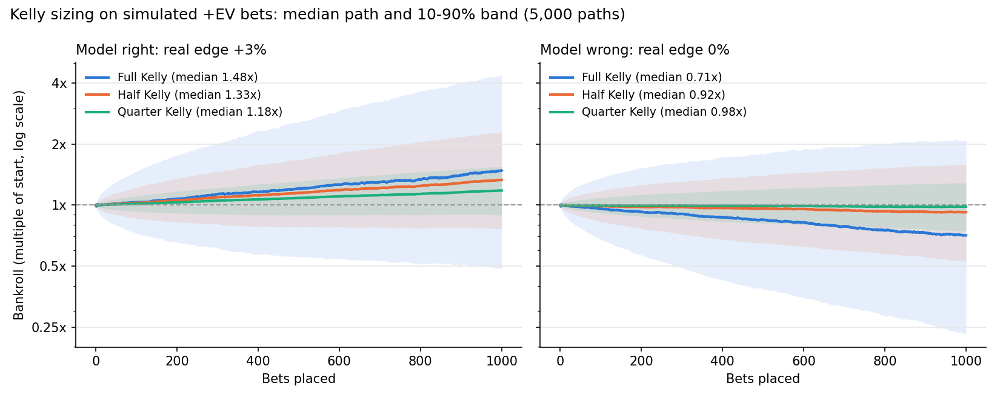

# Bet-opportunity (Edge Scanner)

> **En bref (FR).** Outil Python qui compare les cotes de nombreux bookmakers (The Odds API) pour repérer
> trois types de situations : arbitrages, « middles » et paris à espérance positive (+EV). La probabilité
> « juste » est estimée en retirant la marge d'un bookmaker de référence (Pinnacle), puis la mise est
> calibrée avec le critère de Kelly (plein ou fractionnaire). Le dépôt contient des tests unitaires, un
> exemple reproductible sans clé d'API et une simulation Monte Carlo de bankroll. Projet de recherche et
> de démonstration : ce n'est pas un conseil de pari et aucun gain n'est promis.

**Arbitrage · Middles · +EV · Kelly sizing · CLV tracking** — Python, Flask, SQLite, pytest.

## The problem

Bookmakers quote different prices for the same event. Two questions follow:

1. **Is a price mispriced?** Only relative to an estimate of the true probability, which nobody observes.
2. **If so, how much should be staked?** Betting too much on a real but small edge still leads to ruin.

This project answers (1) with a market-based estimate (a sharp bookmaker's margin-free price) and (2) with
the Kelly criterion, and keeps a history of every signal so its quality can be checked afterwards (CLV,
Brier score, realised ROI).

## Method

| Step | Formula | Code |
|---|---|---|
| Implied probability of decimal odds `o` | `1 / o` | `odds_math.implied_probability` |
| Bookmaker margin of a market | `Σ 1/o_i − 1` | `odds_math.remove_margin` |
| Fair odds (proportional de-vig) | `p_i = (1/o_i) / Σ 1/o_j`, fair odds `= 1/p_i` | `odds_math.remove_margin` |
| Edge of a soft-book price | `o / o_fair − 1` | `odds_math.edge_percent` |
| Expected value per unit | `p · (o − 1) − (1 − p)` | `odds_math.expected_value` |
| Full Kelly fraction | `f* = (p·b − q) / b`, `b = o − 1`, `q = 1 − p` | `odds_math.kelly_fraction` |
| Fractional Kelly stake | `k · f* · bankroll`, `k ∈ {1, ½, ¼, 1/10}` | `odds_math.kelly_stake` |
| Exchange commission | `1 + (o − 1)(1 − c)` | `odds_math.odds_after_commission` |

The three detectors live in `scanner.py`:

- **+EV**: Pinnacle (or Betfair Exchange / Matchbook) is the reference. Its margin is removed over the whole
  market (2-way, or 3-way home/draw/away for soccer) and every soft-book price above the fair price by at
  least `MIN_EDGE_PERCENT` (1% by default) is reported with its EV and Kelly stake.
- **Arbitrage**: best price per side across books; if `Σ 1/o_best < 1`, stakes proportional to `1/o`
  lock in the same payout whatever the result.
- **Middles**: two spread/total lines from different books that leave a window where both bets win. The
  probability of landing in the window comes from a per-point table by sport (`config.py`), with NFL key
  numbers (3, 7, 10…) weighted separately.

**Assumptions.** The sharp price is an unbiased estimate of the true probability; the proportional
method spreads the margin evenly (it ignores the favourite–longshot bias, see Limits); outcomes of
different bets are independent; there are no pushes/voids (a soccer draw on the selected side counts as a
loss in the history statistics).

## Reproducible example (no API key needed)

`examples/sample_odds.json` contains **synthetic** odds for two fictional matches, in The Odds API v4
format. The offline pipeline `scanner.analyze_events` runs on it:

```bash
python examples/run_example.py
```

```
+EV bets (sharp reference: Pinnacle, margin removed proportionally, quarter Kelly, bankroll 1000)
  Mesa Ridge Miners vs Harbor City Hawks   Harbor City Hawks    DraftKings    odds 2.06  fair 2.000  edge +3.00%  EV/100 +3.00  full Kelly 2.83%  stake 7.08
  Eastvale United vs Northport FC          Northport FC         Winamax (FR)  odds 2.22  fair 2.183  edge +1.68%  EV/100 +1.68  full Kelly 1.38%  stake 3.44

Arbitrages (stake 100)
  Mesa Ridge Miners vs Harbor City Hawks   h2h      ROI +1.48%  [Harbor City Hawks @ 2.06 (DraftKings), Mesa Ridge Miners @ 2.00 (FanDuel)]

Middles (stake 100)
  Mesa Ridge Miners vs Harbor City Hawks   Harbor City Hawks by 2-3     P(middle) 5.0%  EV +1.05%
```

Reading the first line: Pinnacle prices both sides at 1.95, i.e. a 2.6% margin and a fair price of 2.00.
DraftKings offers 2.06, a 3% edge. Full Kelly would stake 2.83% of the bankroll; quarter Kelly stakes 0.71%.
The numbers are illustrative, not observed market data.

## Bankroll simulation: full vs fractional Kelly

`examples/simulate_bankroll.py` runs 5,000 Monte Carlo paths of 1,000 bets (odds drawn in [1.7, 3.0], fixed
seed). The model always *believes* it has a +3% edge. Two worlds use the same random draws: the edge is real,
or the edge was pure estimation error (true edge 0%).



| World | Sizing | Median final bankroll | P(final < start) | P(max drawdown ≥ 50%) |
|---|---|---|---|---|
| Real edge +3% | Full Kelly | 1.48× | 32.8% | 65.3% |
| Real edge +3% | Half Kelly | 1.33× | 25.9% | 7.4% |
| Real edge +3% | Quarter Kelly | 1.18× | 22.5% | 0.0% |
| Real edge 0% | Full Kelly | 0.71× | 64.7% | 85.0% |
| Real edge 0% | Half Kelly | 0.92× | 57.5% | 23.9% |
| Real edge 0% | Quarter Kelly | 0.98× | 53.2% | 0.3% |

Takeaways: even with a genuine 3% edge, 22–33% of paths still end below their start after 1,000 bets, and
full Kelly halves the bankroll at some point in two paths out of three. When the estimated edge is wrong, the
median full-Kelly bankroll falls to 0.71× while quarter Kelly stays close to 1×. This is why the app defaults
to quarter Kelly.

## Honest limits

- **Model risk.** The edge is an *estimate*: it is only as good as the assumption that the sharp book is
  right. Proportional de-vigging ignores the favourite–longshot bias (methods such as Shin's are on the
  roadmap). A 1–3% edge is of the same order as these estimation errors.
- **Variance.** Small edges need hundreds to thousands of bets before realised ROI means anything; this is
  why the app also tracks closing line value (CLV), a faster but still noisy signal.
- **Execution.** Prices move between detection and placement; the Odds API snapshot can be stale; an
  arbitrage with one leg filled and the other gone is a plain bet.
- **Bookmaker rules.** Soft bookmakers routinely limit or close accounts that win or that bet like
  arbitrageurs, and their terms allow voiding "obvious errors". Any long-run edge is therefore capped by how
  long accounts stay open.
- **Middles.** The window probabilities are rough per-sport averages, not a fitted model.
- **Legal.** Online betting is regulated differently in every country (in France only ANJ-licensed operators
  are legal). Check local law before using any of this with real money.

**This is a research and educational project, not betting advice. Nothing here promises a profit; sports
betting can lose money.**

## Run it

Requires Python 3.9+.

```bash
git clone https://github.com/pavass06/Bet-opportunity.git
cd Bet-opportunity
python3 -m venv .venv && source .venv/bin/activate
pip install -r requirements-dev.txt        # app + tests + simulation

pytest                                     # unit tests (no network)
python examples/run_example.py             # offline example on synthetic odds
python examples/simulate_bankroll.py       # regenerates docs/bankroll_simulation.png
```

Live scanning needs a free key from [the-odds-api.com](https://the-odds-api.com/) (500 requests/month on the
free tier; one full scan of the 11 default sports uses 12 requests):

```bash
cp .env.example .env        # then put your key in ODDS_API_KEY (the .env file is git-ignored)
python app.py               # opens the dashboard in the browser (port 5000, else 5050 / 8000)
```

The key can also be typed in the UI, but the background job that fetches closing odds for CLV only reads it
from `.env`. No key is stored in the code or in the database.

## Project layout

```
odds_math.py          pure pricing functions (margin removal, edge, EV, Kelly, commission)
scanner.py            The Odds API client + analyze_events(): arbitrage, middles, +EV detection
config.py             sports, markets, bookmakers, default parameters
db.py                 SQLite history: +EV signals, closing odds, CLV, W/L results, Brier score
scheduler.py          background job fetching Pinnacle closing odds every 30 min
app.py                Flask server and JSON endpoints
templates/, static/   single-page dashboard (Arbitrage / Middles / +EV / Builder / History tabs)
examples/             synthetic sample odds, offline example, Monte Carlo simulation
tests/                pytest suite
```

## Credits and licence

Started as a fork of Adrian Boniface's open-source sports arbitrage scanner (MIT, see `LICENSE`): the
original provided the arbitrage, middles and first +EV scanner. Added in this fork: 3-way markets and EU
books, SQLite persistence with CLV tracking, manual results with Brier score and realised ROI, a parlay
builder, the pure `odds_math` module, the offline example, the bankroll simulation and the test suite.
